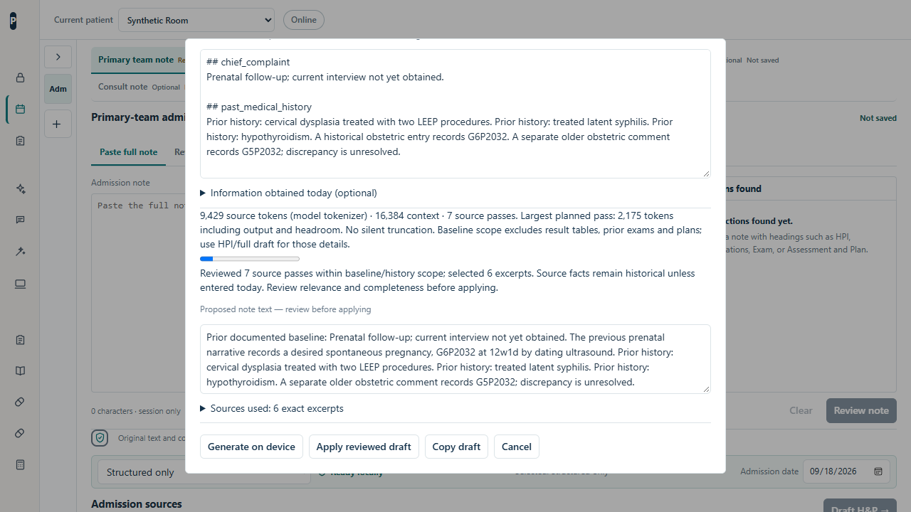

# Local draft refinement

2026-10-15. All evaluation records are synthetic. No patient messages were copied into fixtures or reports. These engineering checks do not establish clinical effectiveness or suitability for unattended documentation.

## Behavior

- One canonical chart: imported sections plus selected clinical data, or an explicitly chosen edited working draft. The app no longer appends both complete representations.
- Actual tokenizer counts after model load, an estimate before load, and visible context, pass count, output reserve and headroom. Longer charts are processed in groups rather than silently truncated.
- Baseline-focused one-liners explicitly exclude labeled result tables, prior exams and prior plans. The meter discloses this scope. Those details remain available in HPI/full drafts. Patient descriptions come from baseline/HPI/narrative sections; history and discrepancies have separate roles. Generic interview questions are excluded from one-liners.
- Reading and reduction passes contain at most 32 source units. Explicit sections, prose versus tables, and prior versus today are kept separate. Result rows remain independently selectable with exact captions, columns, units and source offsets. Equal values from different panels retain their own provenance.
- Other note types retain up to six selected excerpts per source domain. Long historical tables cannot displace a short narrative finding, medication discrepancy or prior plan from the same pass or reduction. Full drafts leave current examination and assessment/plan blank and add status blanks beside retained prior follow-up actions.
- Facts are assembled from exact source quotations. Task-specific JSON schemas constrain IDs, counts and question choices; local validators reject wrong IDs/roles, incomplete output and unsupported question text. Today's entered updates are retained independently of model selection. Selection can still omit relevant information.
- The final local privacy scan remains mandatory. Clinicians can keep redactions or explicitly restore a false positive as Not PHI. Apply/Copy remain blocked while decisions are pending. Undo redacts again. Exact alignment handles existing placeholders; unmappable transformations cannot be restored automatically. Originals and decisions remain session-only and are cleared with the dialog/session.

## Runtime and memory boundary

Repeated inference calls increased GPU memory on the test laptop even after chat resets. A single isolated long-table case passed, but continued calls and UI checks increased total device usage from roughly 0.8 GB before loading to over 10 GB. Longer multi-note runs also recorded GPU device loss; the subsequent GrammarMatcher error was a secondary symptom. This does not prove that every device-loss incident had the same cause.

A worker now handles at most eight drafting inference calls (verification self-tests are separate) before the pipeline releases it and reloads the same cached model with mandatory self-tests. Progress explicitly reports refreshes. There is no model substitution, cloud fallback or retry of failed clinical output. Source/session cancellation between release and reload stops the next worker from starting. Closing the draft dialog always releases the worker. Worker commands serialize so reset or model replacement cannot overlap generation; offline restrictions still take effect immediately.

The bundled runtime also contained the borrowed shape-tuple lifetime defect documented in [WebLLM issue 844](https://github.com/mlc-ai/web-llm/issues/844). The caller-reference fix from merged [TVM PR 20501](https://github.com/apache/tvm/pull/20501) is backported and tested. That fix alone did not eliminate observed device loss, so bounded worker lifetimes are a separate resource boundary. All six pinned model libraries were checked for the required native reference-count exports; actual load/self-tests additionally exercised the 4B model. See [vendor patch notes](../vendor/web-llm/PATCHES.md).

## Evaluation boundaries

Real native WebGPU execution uses installed Edge on the RTX 5070 Ti laptop with 12,227 MiB dedicated memory. The headless Playwright runs use `--enable-unsafe-webgpu --ignore-gpu-blocklist --use-angle=d3d11`; unflagged browser behavior was not separately measured. The M2 Mac was not tested. Timings include machine workload, model reloads and concurrent regression checks; they are not isolated performance measurements. GPU samples cover the entire device, including other applications.

Five dense fixtures include prenatal baseline/discrepancies, renal results and medication-dose uncertainty, a full prechart with medication/allergy/follow-up detail, anticoagulation uncertainty, and a fresh table-only potassium/creatinine target. Raw inputs contain more than 12,679 tokens according to the loaded tokenizer. One-liners deliberately process the disclosed baseline scope; HPI/full cases inspect all source units. The first four cases became development-informed regressions. The fifth was added before inspecting its output; instructions were not tuned in response to it.

Checks cover exact provenance, required facts, baseline-role placement, temporal separation, absence of invented treatment, output length, actual local Stanford privacy review and explicit Apply. They do not comprehensively score clinical relevance. A draft may still contain an irrelevant historical value or miss a useful fact. Earlier passing literal checks missed excess panel copying; length and table-only targets were added rather than treating those passes as sufficient.

## Final results

- 4B: [8/8 shorter regressions](local-note-evaluation/refinement-final-short-4b.json) and [5/5 dense cases](local-note-evaluation/refinement-final-dense-4b.json). Dense raw inputs were 13,798–14,008 tokens. The scoped one-liner took 17.6 seconds; full-source HPI/full-note cases took 177.6–201.6 seconds, including model reloads. Drafts were 412–2,824 characters.
- The actual 4B UI generated a full-source dense table-based HPI, ran the real Stanford scanner, and passed explicit Apply with the critical rows and prior follow-up intact. A baseline-focused one-liner also passed preview/Apply with baseline, LEEP history and treated syphilis retained. Those 4B runs recorded no device-loss errors or external writes.
- Sampled total device memory peaked at 6,264 MiB in the shorter run and 6,432 MiB in the dense run. Samples include all GPU processes; they are not per-model allocations or guaranteed instantaneous maxima. See [short-run samples](local-note-evaluation/final-basic4b-gpu.csv) and [dense-run samples](local-note-evaluation/final-dense4b-gpu.csv).
- 9B: [0/2 focused checks](local-note-evaluation/refinement-failed-focused-9b.json). It omitted the supplied patient baseline and triggered `DXGI_ERROR_DEVICE_HUNG` during the table case despite bounded workers. Subsequent model verification/UI checks did not complete. It is withdrawn from note drafting, with a warning on its separate experimental AI Chat option. The application now also rejects an empty baseline when a patient-description source was provided; it does not publish the resulting history-only fragment.

[All six library export checks](local-note-evaluation/runtime-library-exports.json) passed. The [device-loss run before bounded workers](local-note-evaluation/refinement-device-loss-before-batches.json) is retained, along with the earlier source-selection failures. Do not reinterpret those historical failures as current passes.

The final baseline-presence guard and task-specific model withdrawal were added after the five-case 4B run. The long-source HPI/full-note algorithm was unchanged. The [focused 4B release rerun](local-note-evaluation/refinement-release-guards-4b.json) passed its dense baseline case and both UI Apply checks after those guards. Its generation/runtime hashes match the release files. `npm.cmd run test:ci` passed on the final release, including local-model, privacy, locked-vault, external-request and clinical safety regressions.

## Reproduce

`npm.cmd run evaluate:local-notes -- qwen3.5-4b --dense --label my-run`

The harness checkpoints each case and hashes generation code, runtime, model registry, fixtures and scoring. Add `--resume` with the same model/label and unchanged generation code to continue an interrupted run; use a fresh label after changes. UI-only changes are recorded and UI checks repeated. Never run two instances against the isolated profile/localhost port simultaneously.

`npm.cmd run test:local-llm` checks source assembly/scope, table provenance, worker batching and cancellation, role validation, exact privacy alignment, worker serialization and the vendored reference-lifetime fix. Browser tests exercise the production source-to-dialog route, privacy decisions/Undo, model controls, source invalidation and session cleanup. `npm.cmd run test:ci` checks the final app.
